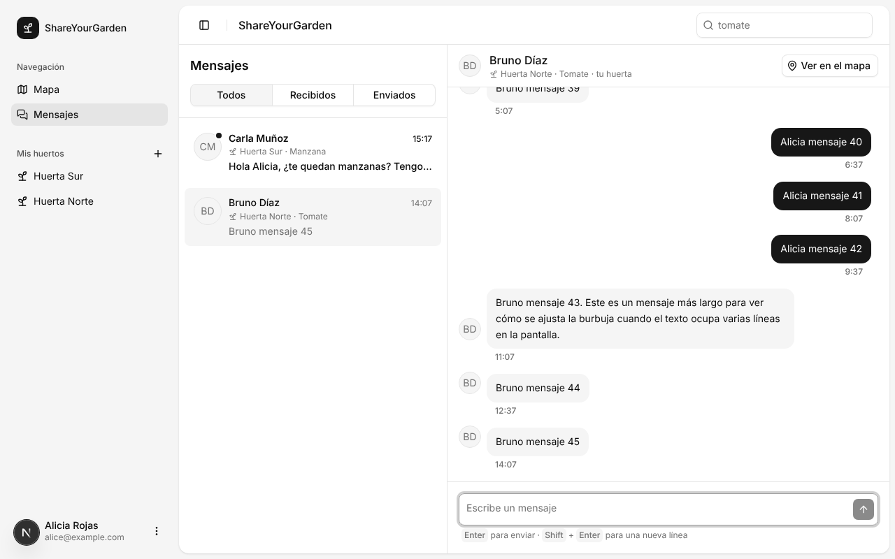
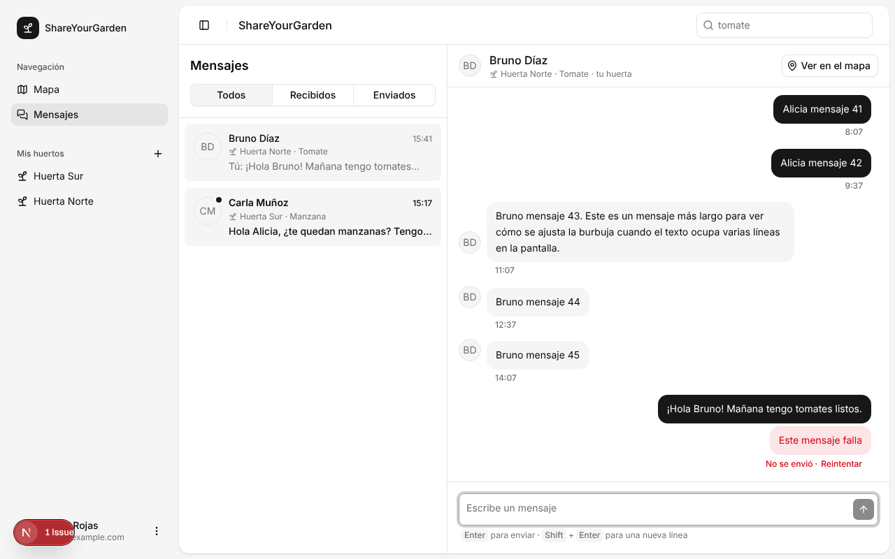
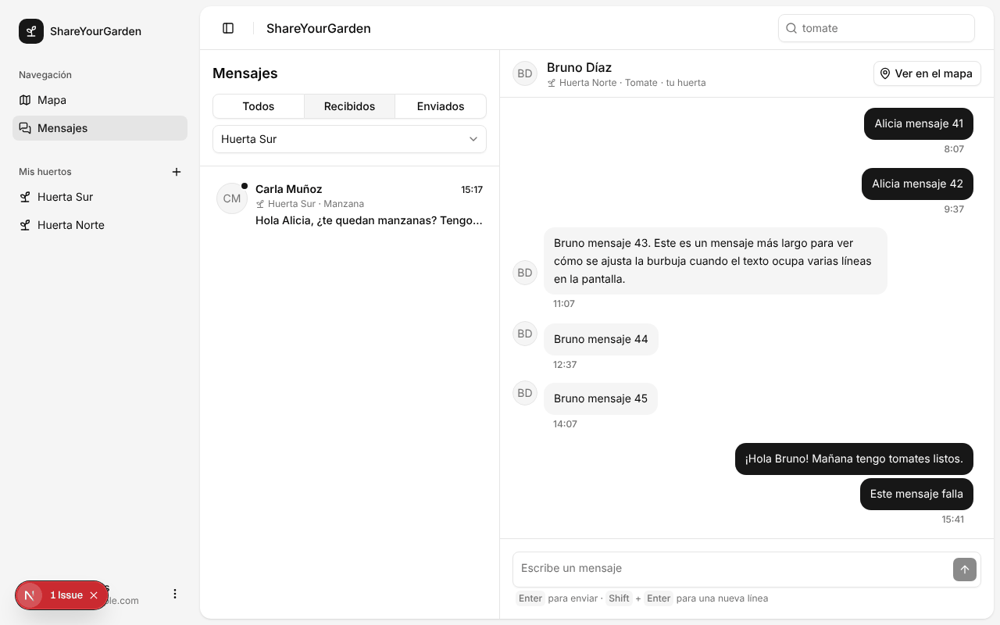
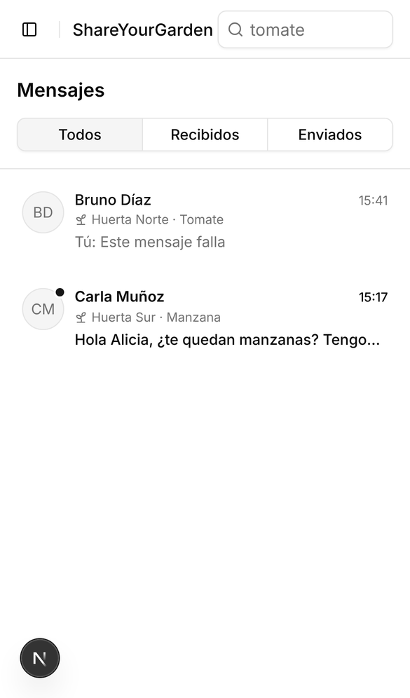
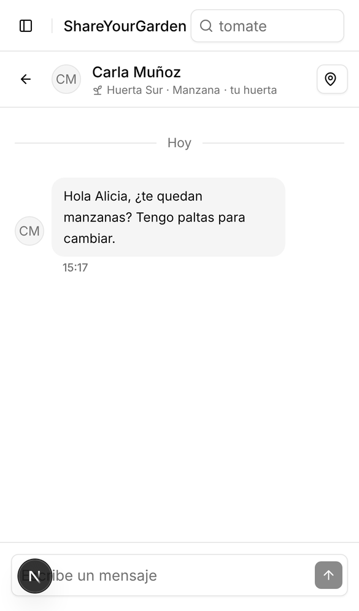
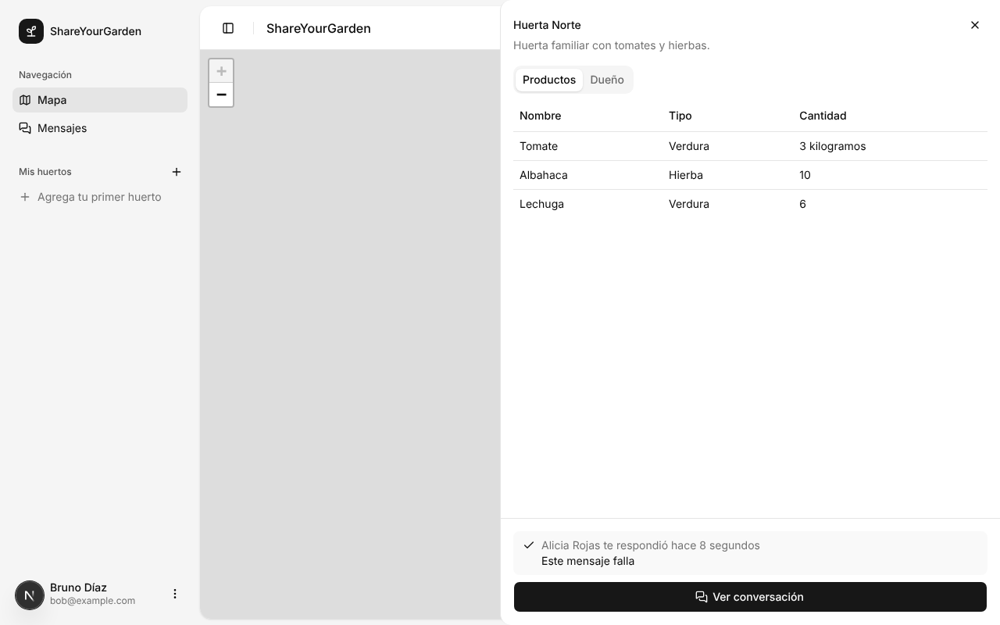

# Capturas de la mensajería

Tomadas con Playwright y datos de prueba durante la fase 3 (bandeja de
mensajes). El aviso "1 Issue" en la esquina es el overlay de desarrollo de
Next.js, provocado por el error 500 que se forzó a propósito para probar el
reintento.

## Bandeja con una conversación abierta (escritorio)

## Mensaje que no se envió, con "Reintentar"

## Recibidos, filtrado por huerta

## Móvil: bandeja y conversación

 

## Drawer de la huerta cuando ya existe una conversación

